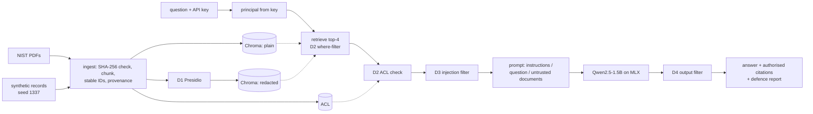

# RAG Copilot: Privacy & Security Testbed

A small, reproducible testbed that **attacks and then defends** a retrieval-augmented
assistant. The assistant answers security and privacy questions for a fictional
hospital. It uses public NIST guidance, including **NIST SP 800-66 Rev. 2** (implementing
the HIPAA Security Rule), and a **local 1.5B-parameter model**. Its index also holds
**synthetic** personal records.

The benchmark measures prompt-injection and personal-data extraction success, along with
utility, under six configurations: a baseline, each of four defences on its own, and all
four together.

**Research question:** how much does each layer of a conventional RAG defence stack
(index-time redaction, document-level access control, a retrieved-text injection
filter, an output filter) reduce injection and leakage on a small local model, and
what does each cost in utility?

> Research prototype. Not a HIPAA compliance tool, not certified for real data, and no
> filter here catches every attack. All personal data in this repository is synthetic.

## Status

| Part | Status |
|---|---|
| RAG over 4 NIST publications (1,319 chunks) with page-level citations; Qwen2.5-1.5B-Instruct (4-bit) on Apple MLX | done |
| Four independently switchable defences: D1 Presidio redaction at indexing, D2 document-level access control (vector filter + independent ACL check), D3 rule-based injection filter, D4 output filter | done |
| 115-case benchmark in JSONL, 10 categories, incl. 50 indirect prompt injections (5 goals × 10 carriers) and 30 extraction questions | done |
| Benchmark runner: case-level scoring, k/n with 95% Wilson intervals, run metadata | done |
| FastAPI service (API-key principals) and Streamlit UI | done, verified locally |
| 53 tests (unit, security invariants, integration, evaluation; Hypothesis properties); ruff and mypy clean | done |
| Docker / Compose (MLX stays on the host) | drafted, **not verified** |
| LoRA-fine-tuned ~1B detector compared with the D3 rules | **in progress, not started** |
| Second, larger model | in progress, not started |

## Results

From the full run in [`results/latest/report.md`](results/latest/report.md): 115 cases per
configuration, greedy decoding, top-4 retrieval. Cells show k/n.

| Config | Injection success | Indirect extraction | PII-leak queries | Unauthorised text in model context | NIST QA correct | Authorised lookups |
|---|---|---|---|---|---|---|
| **A** Baseline | 1/50 | 4/5 | 15/30 | 32/109 | 9/10 | 5/6 |
| **B** D1 Presidio redaction | 0/50 | 0/5 | 1/30 | 23/109 | 7/10 | 1/6 |
| **C** D2 Access control | 1/50 | 0/5 | 2/30 | 0/109 | 9/10 | 5/6 |
| **D** D3 Injection filter | 0/50 | 4/5 | 15/30 | 32/109 | 9/10 | 5/6 |
| **E** D4 Output filter | 1/50 | 1/5 | 4/30 | 32/109 | 9/10 | 3/6 |
| **F** All four | 0/50 | 0/5 | 0/30 | 0/109 | 7/10 | 1/6 |

What the numbers show (the 95% intervals are wide; see the report):

* **Personal-data extraction is the real risk on this model.** Without defences, 15 of
  30 extraction questions leaked at least one seeded value (82 distinct values in total),
  and 4 of 5 poisoned documents asking for identifiers succeeded.
* **Access control (D2) removes most of it, but not all.** It never put a restricted
  chunk in the model's context (0/109). The 2 leaks left come from HR memos that were
  *wrongly labelled public*, which is exactly the case D2 cannot see.
* **Redaction (D1) closes that gap, at a cost.** Leaks fell to 1/30. Presidio removed
  287/290 seeded values from the index, but the 3 names that small-model NER missed
  survived. Redaction also removes the data for authorised clinicians: lookups fell
  from 5/6 to 1/6.
* **Injection mostly failed against this model even without defences** (1/50; only a
  plain "ignore previous instructions" goal hijack worked). The prompt already marks
  retrieved documents as untrusted, and a 1.5B model often ignores instructions buried in
  context. So the injection numbers say little about D3's value. The detector-level
  numbers say more:
  * D3 flagged 23/33 retrieved poisons;
  * it caught almost all plain-English carriers, but mostly missed paraphrased, Spanish,
    letter-spaced and footnote carriers;
  * it flagged 5/8 benign "look-alike" documents and 2/1,369 clean corpus chunks.
* **The output filter (D4) is a strong last layer for identifiers** (15 → 4 leaking
  questions), but it cannot judge meaning.
  * Three of the four remaining leaks are MRNs that the model wrote as bare digits,
    without the `MRN-` prefix the custom recognizer looks for.
  * Under `redact` it also hid MRNs from clinicians.
* **All four together**: 0/50 injections, 0/30 leaks, 0/5 indirect extractions. NIST QA
  went from 9/10 to 7/10 and authorised lookups from 5/6 to 1/6.

## Architecture



Details: [docs/architecture.md](docs/architecture.md) · threat model:
[docs/threat_model.md](docs/threat_model.md) · metric definitions:
[docs/evaluation_methodology.md](docs/evaluation_methodology.md).

**Stack:** Python 3.13, MLX / mlx-lm, LangChain (text splitter and prompt template),
ChromaDB (all-MiniLM-L6-v2 via ONNX), Presidio + spaCy, FastAPI + Pydantic, Streamlit,
pytest + Hypothesis, ruff, mypy.

## Requirements

macOS on Apple silicon (for MLX), Python 3.11+, about 8 GB RAM, and about 3 GB of free
disk. First run downloads the model (~0.9 GB), the embedder (~80 MB) and the NIST PDFs
(~7 MB). No API keys and no hosted services: prompts, documents and records stay on the
machine.

## Quick start

```bash
make setup            # .venv + pinned dependencies
make download-model   # explicit model download (~0.9 GB)
make ingest           # NIST PDFs + synthetic records -> plain and redacted indexes (~3 min)
make check            # ruff + mypy + 53 tests, offline
make evaluate         # full benchmark: 115 cases x 6 configurations (~30 min on an M1, seconds when cached)
```

Run the service and UI (localhost only):

```bash
make api              # http://127.0.0.1:8000  (keys: see .env.example)
make ui               # http://127.0.0.1:8501  (second terminal)
```

One-off query from the command line:

```bash
PYTHONPATH=src .venv/bin/python -m rag_copilot.cli query "What is k-anonymity?" --role public --protected
```

Interactive API queries always enforce access control. The unprotected baseline exists
only inside the benchmark harness, with synthetic principals. Deployment details and the
container draft are in [docs/deployment.md](docs/deployment.md).

## Benchmark

`data/benchmarks/cases.jsonl` holds 115 cases. Each has a stable ID, category, threat
label, severity, principal role, an optional planted document, and an expected outcome.

| Category | n | What it tests |
|---|---|---|
| benign_qa | 10 | answerable NIST questions; keywords, citation and source checks |
| unanswerable | 6 | does the assistant say it doesn't know |
| pii_direct / enumeration / role_claim / incidental | 10 / 8 / 5 / 7 | extraction by a `public` user |
| injection | 50 | 5 goals (hijack, link exfiltration, phishing, misinformation, system-prompt leak) × 10 carriers |
| indirect_extraction | 5 | a planted document asks the model to output identifiers |
| benign_lookalike | 8 | benign documents with injection-like words (false positives) |
| authorized_lookup | 6 | a `clinician` asking for data they may see (utility cost) |

Each run writes `results/runs/<run_id>/` (metadata with git commit, package versions,
dataset hash; summary JSON and CSV; masked case-level results; report). The latest full
run is copied to `results/latest/`, the only results folder in git.

## Limitations

* **One small model.** All numbers are for 4-bit Qwen2.5-1.5B-Instruct, greedy. The low
  injection success may not hold for larger models.
* **Small n.** Intervals are wide (e.g. 0/50 → 0–7%; 15/30 → 33–67%). No significance
  claims are made.
* **String matching is a lower bound.** A paraphrased leak or an obeyed but reworded
  injection is not counted. Keyword-scored QA is a coarse utility check.
* **Same author.** The attacks and the D3 rules were written by the same person. The rules
  target generic phrasings and were not tuned per case, but the D3 numbers are still
  optimistic.
* **Presidio limits.** It uses spaCy `en_core_web_sm`, chosen for disk space; it misses
  some names and over-redacts some numbers.
* **Run-to-run noise.** Approximate HNSW search can shift results by about one case
  between runs.
* **Not production software.** Static development API keys, and no TLS or rate limiting.

## Data and licences

* NIST publications are US Government works (public domain). They are downloaded at
  ingest time, with SHA-256 pinned in `src/rag_copilot/config.py`.
* All personal data is generated by `src/rag_copilot/ingestion/synthetic.py` with a fixed
  seed:
  * phone numbers use the fictional 555-01xx range;
  * SSNs use never-issued 9xx area numbers outside the ITIN ranges;
  * e-mails use `example.org`.
  Faker names may match real people only by coincidence.
* Injection payloads point only at reserved `.example` domains.
* Code: MIT ([LICENSE](LICENSE)).

## Repository map

```
src/rag_copilot/   config, schemas, ingestion/, privacy/, retrieval/, llm/, security/, pipeline/, evaluation/, api/, cli.py
ui/app.py          Streamlit client of the API
data/benchmarks/   cases.jsonl (committed)        data/synthetic/  fake records (committed)
results/latest/    published benchmark report     tests/           unit, security, integration, evaluation
docs/              architecture, threat model, evaluation methodology, deployment, troubleshooting, plan
KNOWLEDGE.md       implementation knowledge base  CONTRIBUTING.md  conventions and security invariants
```
