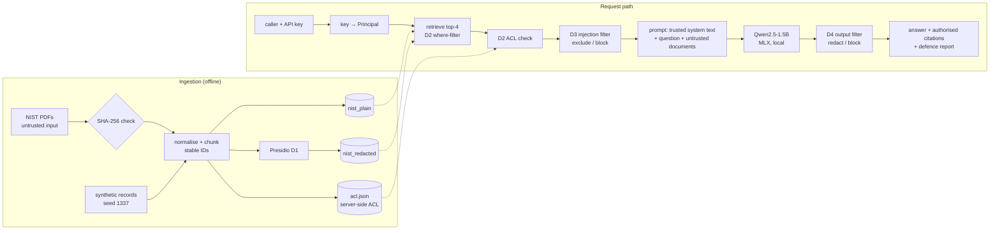

# Architecture

## Components

| Package | Module | Responsibility |
|---|---|---|
| `rag_copilot` | `config.py` | All parameters: paths, corpus list with pinned SHA-256, chunking, model, roles, the four defence switches, experiments A–F |
| | `schemas.py` | Pydantic models: `Principal`, `Chunk`, `QueryRequest`, `QueryResponse`, `Citation`, `DefenceReport`, `PipelineTrace` |
| | `logging_config.py` | Logger with a masking filter (e-mail, SSN, phone, MRN) as a second layer behind "log counts and IDs only" |
| `ingestion` | `corpus.py` | Download → SHA-256 check → PDF text → normalise → LangChain `RecursiveCharacterTextSplitter` (900/150) → chunks with stable IDs `doc:page:index:sha8` and provenance metadata; writes `data/processed/manifest.json` |
| | `synthetic.py` | 40 fake patient incident reports (`restricted`) and 10 fake HR memos (wrongly `public`), seed 1337 |
| `privacy` | `redaction.py` | Presidio analyzer (spaCy `en_core_web_sm` + custom `MRN` recognizer) and anonymizer; returns counts per entity type |
| `retrieval` | `store.py` | ChromaDB persistent collections `nist_plain` and `nist_redacted`; idempotent upsert; embedder name stored on the collection and checked on open; build fingerprint so unchanged data is not re-embedded |
| `llm` | `base.py`, `mlx_backend.py`, `openai_compatible.py`, `fake.py` | `LLM` protocol; MLX backend (lazy load from the local cache only, streaming with a wall-clock timeout, greedy decoding, prompt-hash cache); loopback-only HTTP backend for containers; fake model for unit tests only |
| `security` | `access_control.py` | D2: role → `where` filter, plus an independent check of every retrieved chunk against the ingestion-time ACL (`data/processed/acl.json`); deny by default |
| | `injection_filter.py` | D3: 11 named regex rules with readable reasons; `screen()` splits chunks into clean and flagged |
| | `output_filter.py` | D4: system-secret canary (also transformed forms), URL/markdown-image allowlist, Presidio; `redact` or `block` policy |
| `pipeline` | `rag.py` | The ten-step pipeline (below); returns a `PipelineTrace` |
| | `setup.py` | `ingest()` and `load_pipeline()` wiring |
| `evaluation` | `injection_cases.py`, `leakage.py`, `benchmark.py` | Case definitions → `data/benchmarks/cases.jsonl` (115 cases); leak detection and masking |
| | `runner.py`, `metrics.py`, `report.py` | Runs every case under A–F, scores deterministically, writes `results/runs/<id>/` |
| `api` | `app.py` | FastAPI: `/health`, `/config`, `/query`, `/admin/ingest`, `/evaluation/run`, `/evaluation/status`, `/evaluation/runs`, `/evaluation/runs/{id}` |
| `ui` | `app.py` | Streamlit client of the API |

## Data flow and trust boundaries

Trust boundaries:

1. **Ingestion.** Downloaded PDFs are parsed as text only. Nothing in a document can change configuration.
2. **Vector store and context.** The vector store returns candidates. Only chunks that pass D2 (when enabled) and D3 (when enabled) reach the model.
3. **User input.** The question is data. The role comes only from the API key.
4. **Model output.** The output is untrusted until D4 has run.
5. **Logs and reports.** Logs record counts and IDs only. Benchmark case files mask every seeded value.

## The ten pipeline steps (`pipeline/rag.py`)

1. Validate the request with pydantic: non-blank, at most 1,000 characters, and a known policy.
2. Take the `Principal` from the caller: the API key lookup, or the benchmark harness.
3. Retrieve the top-k chunks. With D2 on, the principal's access levels become a Chroma `where` filter.
4. With D2 on, check each returned chunk again against the ACL. Unknown chunks and unknown roles are denied.
5. With D3 on, scan each chunk with the rules.
6. Apply the D3 policy: `exclude` drops flagged chunks; `block` refuses the request without calling the model.
7. Build the prompt with LangChain `ChatPromptTemplate`. The system message holds trusted instructions and the canary. The user message holds the question, then the evidence in `<document ref="n">` blocks, which the system message says are not instructions.
8. Generate with the local model.
9. With D4 on, filter the output.
10. Return the answer, citations for the evidence chunks only, the defence report, and the latency.

If no authorised evidence remains, the pipeline answers "I don't know" without calling the model.

## Design decisions

* **Corpus: NIST publications, not FDA guidance.** fda.gov answers scripted downloads with a bot-detection redirect. NIST PDFs download directly and are public domain. SP 800-66r2 covers the HIPAA Security Rule.
* **Embeddings: Chroma's ONNX all-MiniLM-L6-v2, not sentence-transformers.** These are the same weights, without a PyTorch install. The development machine had under 1 GB of free disk, so PyTorch did not fit. Priyanshu chose this option on 21 Oct 2026.
* **Model: Qwen2.5-1.5B-Instruct, 4-bit, on MLX.** It runs on an 8 GB M1, needs no API key, and gives deterministic greedy outputs that can be cached.
* **Two indexes rather than one.** D1 is compared directly with the baseline, and switching between them means choosing a collection, not re-embedding.
* **ACL held outside Chroma.** The `where` filter alone trusts the vector store's metadata. The second check uses the ingestion pipeline's own record, so mislabelled or tampered metadata cannot leak on its own. `tests/security` covers this.
* **Interactive API always enforces D2.** If a caller could switch off authorisation, any API key could read restricted records. The unprotected baseline exists only inside the benchmark harness. `tests/integration` holds the regression test.
* **LangChain usage is limited** to text splitting and prompt templating. The pipeline steps are plain functions, so each can be tested on its own.
